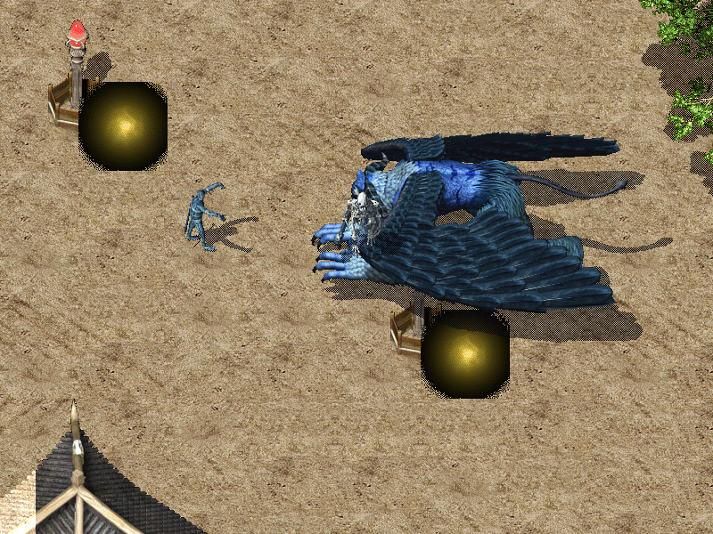
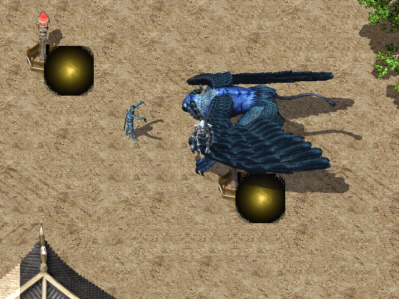
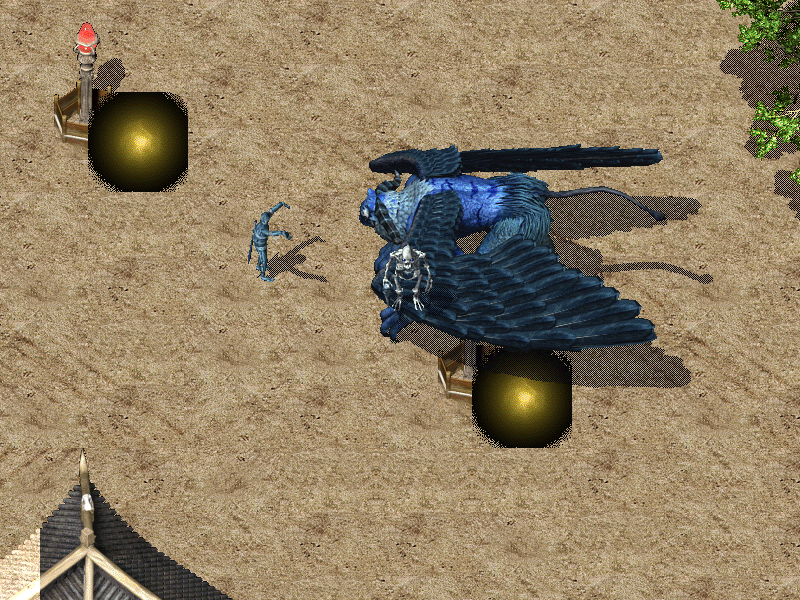
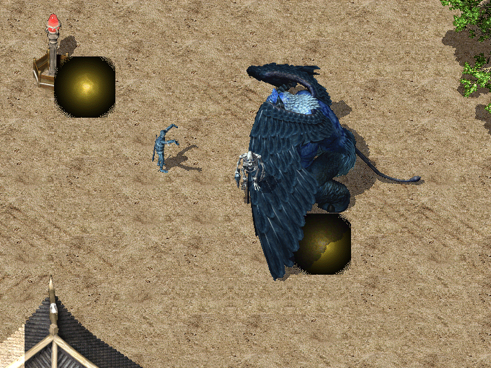

# R49 C · 怪物走/跑插值证据

本轮把怪物（`EntityKind::Monster`）的 `S.ObjectWalk`/`S.ObjectRun` 接到
Crystal `MonsterObject.cs:345-433` 的原生插值；玩家（R46）和自机（R45）的
逻辑未改。

## 公式

* 只有 `Walking`/`Running` 建立 `MonsterMotion`；
* `Movement = CurrentLocation` 身后 1/2 格（`from`），渲染基点是 `Movement`；
* 8 方向 offset 用 `CellW=48/CellH=32`、`Count/Interval`；
* 末尾 `x % 2 + x`（C# 负数截断余数语义，不能用 `rem_euclid`）；
* 排序锚点 `DrawY = max(Movement.Y, CurrentLocation.Y)`；
* 动作结束/受击/死亡/删除/切图/断线清 motion；Push/Jump/Dash 未扩。

## 真实证据

`monster_motion`（ignored）用默认 `game-assets` 的 `maps/0.mnm` +
`gfx` 原生拆包，向三只怪物（image 5/22/184，不同方向、不同 Walk 帧数）
应用真实 `S.ObjectMonster`/`S.ObjectWalk`，相机中心固定 `334,270`，在
0/500/600/1000ms 渲染 4 张：






`manifest.json` 记录每帧 `camera_center/position/pixel_offset`、模拟时间与
文件时间；三只方向不同的怪物 offset 不同（Right 首帧 `(8,0)`，Down 首帧
`(0,6)`，Left 首帧 `(-4,0)`），500ms 时分别为 `(48,0)`/`(0,32)`/`(-28,0)`；
600ms 时 005/022（6×100ms）已落点、offset 归零，184（10×100ms）仍在走，
1000ms 落点归零。005/022 的 Walk 帧表数值相同，184 的 10×100ms 用于证明
时长按每只怪自己的 Count×Interval 生效。

## 测试

```text
TEMP=target/tmp TMP=target/tmp cargo test -p mir-client --lib camera::monster_motion_tests
TEMP=target/tmp TMP=target/tmp cargo test -p mir-client --lib monster_walk_uses
TEMP=target/tmp TMP=target/tmp cargo test -p mir-client --test monster_motion -- --ignored --nocapture
```

## 边界

* 未做 Push/Jump/DashAttack、坐骑帧表、窗口四边界与 FPS/帧耗时实测；
* `frames.json` 缺表时回退 6×100ms；有表但缺单帧由渲染端安静跳过（不跨动作借帧）；
* 本测试只写本目录；R49 起攻击 live 证据只写 `target/attack-variants/`（gitignored），
  R47 的 `docs/testing/attack-variants/` 只读。该目录 2026-10-25 03:41 复核时
  `git status` 为 0，但刑部审计时曾出现 27 个 tracked M，所以“0 diff”只是采样结论、
  不是长期保证，恢复由队长执行 `git checkout -- docs/testing/attack-variants/`。
* 当前工作树最终全量门禁未跑：`current_gate=PARTIAL`，不沿用历史批次结论。
